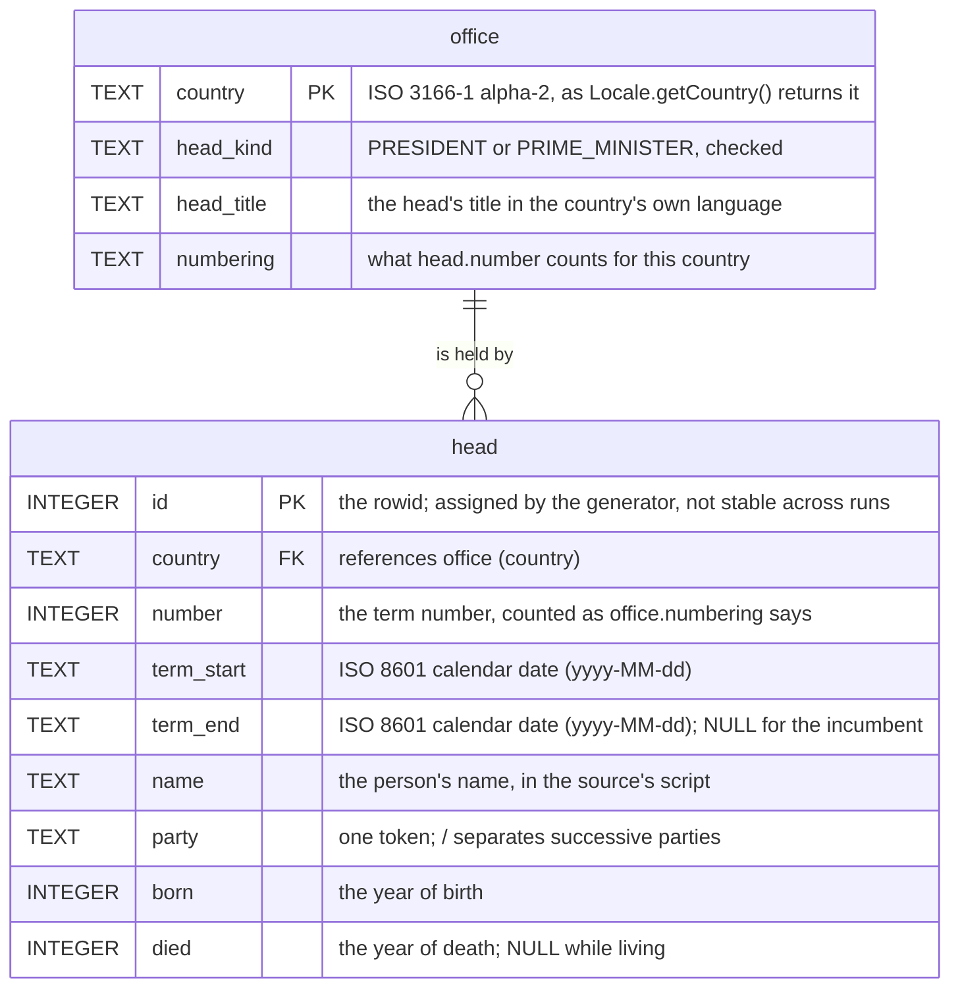

# heads_of_governments.sqlite3

Generated by `./mvnw test` from the `.asv` files under `src/main/resources`, which are the flattened
forms of the `.txt` lists beside them. The file is committed, so a change to a list is a change to it too.

## .schema

```sql
CREATE TABLE office (
    -- the office the head of government holds; one row per country
    country    TEXT NOT NULL PRIMARY KEY,                    -- ISO 3166-1 alpha-2: FR, GB, JP, KR, US
    head_kind  TEXT NOT NULL,                                -- PRESIDENT or PRIME_MINISTER
    head_title TEXT NOT NULL,                                -- the head's title, in the country's language
    numbering  TEXT NOT NULL,                                -- what head.number counts for this country
    CHECK (head_kind IN ('PRESIDENT', 'PRIME_MINISTER'))
) WITHOUT ROWID;

CREATE TABLE head (
    -- one term of a head of government
    id         INTEGER PRIMARY KEY,                          -- the rowid; assigned by the build, not stable
    country    TEXT    NOT NULL REFERENCES office (country), -- the office's country
    number     INTEGER NOT NULL,                             -- the term number, as office.numbering says
    term_start TEXT    NOT NULL,                             -- ISO-8601 date, yyyy-MM-dd
    term_end   TEXT,                                         -- ISO-8601 date; NULL for the incumbent
    name       TEXT    NOT NULL,                             -- the person's name, in the source's script
    party      TEXT    NOT NULL,                             -- one token; / separates successive parties
    born       INTEGER NOT NULL,                             -- the year of birth
    died       INTEGER,                                      -- the year of death; NULL while living
    CHECK (term_end IS NULL OR term_end >= term_start),
    CHECK (died IS NULL OR died >= born)
);

CREATE INDEX idx_head_country_number ON head (country, number);
CREATE INDEX idx_head_term_start ON head (term_start);
CREATE INDEX idx_head_term_end ON head (term_end);
CREATE INDEX idx_head_name ON head (name);
CREATE INDEX idx_head_born ON head (born);
CREATE INDEX idx_head_died ON head (died);
```

## As a diagram



The crow's foot is what the schema declares: a head belongs to exactly one office, and nothing stops
an office from having no head. The generator asserts the rest after the inserts -- every office has
at least one term, exactly one with `term_end IS NULL`, and no `(country, term_start)` repeats -- so
the file as built is stricter than the diagram. The same as images, generated from the DDL's keys by the
`erd` skill and not drawn by hand: [both tables](../docs/erd/__heads_of_governments.svg),
[office alone](../docs/erd/office.svg), [head alone](../docs/erd/head.svg).

## `office`

The office the head of government holds -- 内閣総理大臣, 대통령, Président de la République -- which is
permanent and has one holder at a time. One row per country.

| name         | description                                                     | notes                              |
|--------------|-----------------------------------------------------------------|------------------------------------|
| `country`    | ISO 3166-1 alpha-2 code, as `java.util.Locale#getCountry()`     | `FR`, `GB`, `JP`, `KR`, `US`       |
| `head_kind`  | what the head of this office is                                 | `PRESIDENT` or `PRIME_MINISTER`    |
| `head_title` | the head's title in the country's own language                  | e.g. `内閣総理大臣`                  |
| `numbering`  | what `head.number` counts for this country                      | free text                          |

## `head`

One term of a head of government. `id` is the key, a surrogate: it is the rowid, assigned by SQLite
as the generator inserts, and the file is regenerated from scratch on every run, so an `id` is not
stable across runs and means nothing outside the file it is in. What identifies a term in practice
is `(country, term_start)`; the generator checks that no pair repeats, but the schema declares no
constraint on it. `number` is not unique within a country everywhere: France and the United Kingdom
keep a person's number across terms.

| name         | description                                   | notes                                        |
|--------------|-----------------------------------------------|----------------------------------------------|
| `id`         | the row's key                                 | rowid; 1..285 by `country`, then `term_start`, in this run |
| `country`    | the office's country                          | references `office`                          |
| `number`     | the term number                               | counted as `office.numbering` says           |
| `term_start` | the first day of the term                     | ISO-8601 date, `yyyy-MM-dd`                  |
| `term_end`   | the last day of the term                      | ISO-8601 date; `NULL` for the incumbent      |
| `name`       | the person's name                             | in the source's script                       |
| `party`      | the party                                     | one token; `/` separates successive parties  |
| `born`       | the year of birth                             |                                              |
| `died`       | the year of death                             | `NULL` while living                          |

The schema declares no uniqueness beyond `id`, by decision: the file is built for its readers, and
the generator checks the data once, at build time, that every `(country, term_start)` is distinct and
that each office has exactly one row with `term_end IS NULL`.

The dates are text, SQLite's own convention, so `WHERE term_start <= '1990-01-01' AND (term_end IS NULL OR term_end >= '1990-01-01')`
finds who held office on a day, and `date()` / `julianday()` work on them directly.
