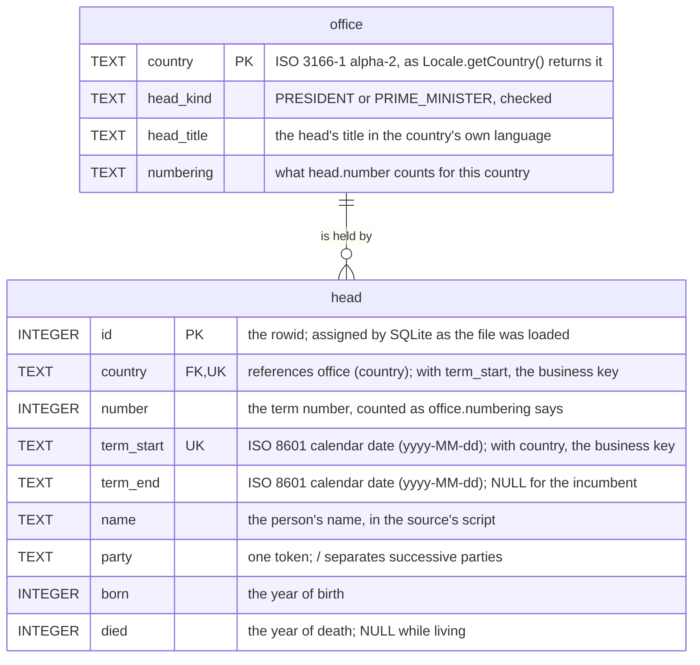

# heads_of_governments.sqlite3

Generated by `./mvnw test` from `schema.sql` and the `.asv` files under `src/main/resources`, the latter
the flattened forms of the `.txt` lists beside them. The file is committed, so a change to the schema
or to a list is a change to it too.

## .schema

```sql
CREATE TABLE office (
    -- the office the head of government holds; one row per country
    country    TEXT NOT NULL PRIMARY KEY,                    -- ISO 3166-1 alpha-2: FR, GB, JP, KR, US
    head_kind  TEXT NOT NULL,                                -- PRESIDENT or PRIME_MINISTER
    head_title TEXT NOT NULL,                                -- the head's title, in the country's language
    numbering  TEXT NOT NULL,                                -- what head.number counts for this country
    CHECK (head_kind IN ('PRESIDENT', 'PRIME_MINISTER'))
) WITHOUT ROWID;

CREATE TABLE head (
    -- one term of a head of government
    id         INTEGER PRIMARY KEY,                          -- the rowid; assigned by the build, not stable
    country    TEXT    NOT NULL REFERENCES office (country), -- the office's country
    number     INTEGER NOT NULL,                             -- the term number, as office.numbering says
    term_start TEXT    NOT NULL,                             -- ISO-8601 date, yyyy-MM-dd
    term_end   TEXT,                                         -- ISO-8601 date; NULL for the incumbent
    name       TEXT    NOT NULL,                             -- the person's name, in the source's script
    party      TEXT    NOT NULL,                             -- one token; / separates successive parties
    born       INTEGER NOT NULL,                             -- the year of birth
    died       INTEGER,                                      -- the year of death; NULL while living
    CHECK (term_end IS NULL OR term_end >= term_start),
    CHECK (died IS NULL OR died >= born)
);

CREATE UNIQUE INDEX idx_head_country_term_start ON head (country, term_start);
CREATE INDEX idx_head_country_number ON head (country, number);
CREATE INDEX idx_head_name ON head (name);
```

## As a diagram



The crow's foot is what the schema declares: a head belongs to exactly one office, and nothing stops
an office from having no head. `UK` marks the business key, `(country, term_start)`, which a unique
index declares. The data was checked for the rest when the file was built -- every office has at least
one term, and exactly one with `term_end IS NULL` -- so the file is stricter than the diagram. The same as images, drawn from the DDL by the build
and not by hand: [both tables](erd/all.svg), [office alone](erd/office.svg),
[head alone](erd/head.svg).

## `office`

The office the head of government holds -- 内閣総理大臣, 대통령, Président de la République -- which is
permanent and has one holder at a time. One row per country.

| name         | description                                                     | notes                              |
|--------------|-----------------------------------------------------------------|------------------------------------|
| `country`    | ISO 3166-1 alpha-2 code, as `java.util.Locale#getCountry()`     | `FR`, `GB`, `JP`, `KR`, `US`       |
| `head_kind`  | what the head of this office is                                 | `PRESIDENT` or `PRIME_MINISTER`    |
| `head_title` | the head's title in the country's own language                  | e.g. `内閣総理大臣`                  |
| `numbering`  | what `head.number` counts for this country                      | free text                          |

## `head`

One term of a head of government. `id` is the key, a surrogate: it is the rowid, assigned by SQLite
as the file was loaded, so an `id` means nothing outside the file it is in. What identifies a term is
`(country, term_start)`, the business key, which the unique index `idx_head_country_term_start`
declares: a country's head does not take office twice on one day. `number` is not unique within a country everywhere: France and the United Kingdom
keep a person's number across terms.

| name         | description                                   | notes                                        |
|--------------|-----------------------------------------------|----------------------------------------------|
| `id`         | the row's key                                 | rowid; 1..285 by `country`, then `term_start`, in this run |
| `country`    | the office's country                          | references `office`                          |
| `number`     | the term number                               | counted as `office.numbering` says           |
| `term_start` | the first day of the term                     | ISO-8601 date, `yyyy-MM-dd`                  |
| `term_end`   | the last day of the term                      | ISO-8601 date; `NULL` for the incumbent      |
| `name`       | the person's name                             | in the source's script                       |
| `party`      | the party                                     | one token; `/` separates successive parties  |
| `born`       | the year of birth                             |                                              |
| `died`       | the year of death                             | `NULL` while living                          |

The schema declares no uniqueness beyond `id` and `(country, term_start)`, by decision: the file is
built for its readers, and the data was checked once, when the file was built, that each office has
exactly one row with `term_end IS NULL`.

`name` is not declared unique either, but within a country it names one person: every repeated
`name` is the same person serving more than one term (Cleveland, Churchill, 吉田茂, 박정희, ...),
and `(country, name)` groups the rows as `(country, name, born)` does. This was checked against the
lists the README cites, including the acting and interim heads they leave out. The only two heads
of government of these five countries who were born with the same name are William Pitt the Elder
(1708-1778) and his son William Pitt the Younger (1759-1806), both prime ministers of the United
Kingdom, and the source list carries the epithets, so the file keeps them apart. Elsewhere only
surnames repeat: Adams, Harrison, Johnson, Roosevelt and Bush in the United States, 加藤, 鈴木,
鳩山, 田中, 福田 and 菅 in Japan, 이, 김, 노, 박 and 윤 in South Korea, Grenville in the United
Kingdom, none in France. A query that counts people, not terms, can therefore `COUNT(DISTINCT name)` per country; it
must not do so across countries, where nothing stops a name from repeating.

The dates are text, SQLite's own convention, so `WHERE term_start <= '1990-01-01' AND (term_end IS NULL OR term_end >= '1990-01-01')`
finds who held office on a day, and `date()` / `julianday()` work on them directly.
